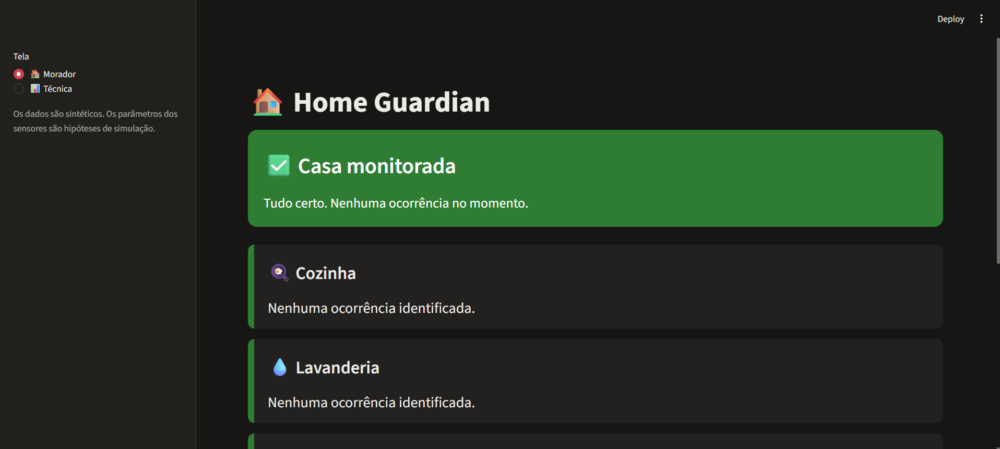
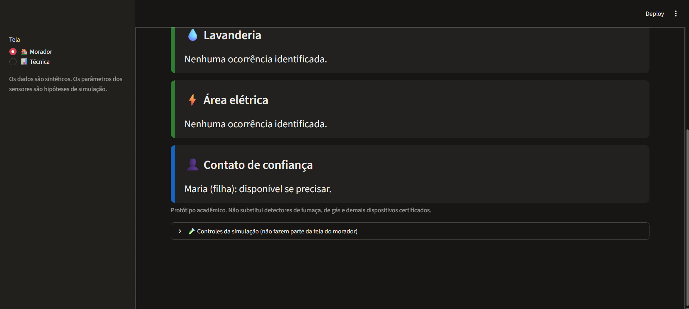
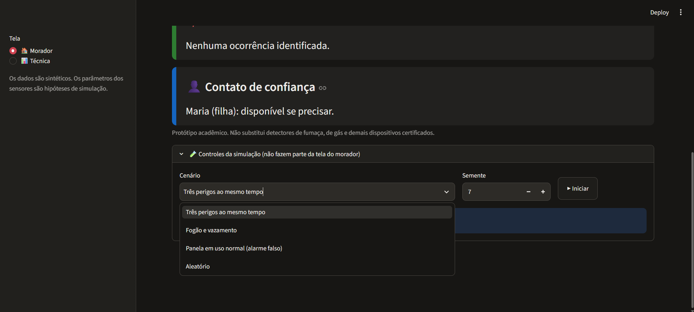

# Home Guardian

Sistema inteligente de segurança e prevenção residencial, desenvolvido para a disciplina de Modelagem Matemática (CDC, 3º semestre) no contexto da **Smart Home 2050**.

O Home Guardian monitora condições domésticas (fogão, vazamento de água, sobreaquecimento de equipamentos), identifica situações potencialmente perigosas e usa **Pesquisa Operacional** para decidir quais ocorrências priorizar e quais ações tomar quando os recursos são limitados.

> **Aviso.** Projeto acadêmico de apoio à decisão. Não substitui detectores de fumaça, de gás e demais dispositivos certificados, que devem continuar funcionando de forma independente. Todos os dados são sintéticos.

## O que o sistema faz

1. **Prevenção.** Lê as séries de sensores, estima a taxa de variação e a aceleração (regressão), calcula o prazo até o valor crítico (Cálculo) e estima a probabilidade de perigo real (regressão logística).
2. **Interação.** Pergunta ao morador ("Você está utilizando o fogão?") e atualiza a probabilidade com o Teorema de Bayes.
3. **Reação.** Uma máquina de estados (Matemática Discreta) conduz cada ocorrência. Quando há ocorrências escaladas, uma **programação linear inteira binária** (PuLP) escolhe as ações que minimizam risco residual, custo e falsos alarmes, respeitando orçamento, prazo, atenção do morador e conflitos.
4. **Análise.** Simulações de cenários, Monte Carlo, sensibilidade e mapa de calor comparam o PLI com duas heurísticas (ingênua(naive) e gulosa(greedy)).

O modelo completo está em [`docs/modelo_matematico.md`](docs/modelo_matematico.md) e a discussão dos resultados em [`docs/relatorio.md`](docs/relatorio.md).

## Estrutura

```
home-guardian/
├── app/                      interface (Streamlit)
│   ├── dashboard.py          ponto de entrada
│   ├── sessao.py             estado e ações do app
│   ├── tela_morador.py       tela simples para o morador
│   └── tela_tecnica.py       tela com a matemática (7 abas + modelo)
├── data/
│   ├── parametros.json       todos os parâmetros do modelo
│   ├── cenarios/             cenários C1 a C6
│   └── home_guardian.db      banco SQLite (gerado)
├── docs/                     modelo, relatório e figuras
├── notebooks/
├── src/home_guardian/
│   ├── config.py
│   ├── sensores/             simulador.py, deteccao.py
│   ├── modelo/               risco, otimizador, heuristica, interacao, estados, calculo, geometria
│   ├── simulacao/            cenarios, monte_carlo, sensibilidade
│   ├── persistencia/         db.py
│   └── relatorios/           graficos.py
└── tests/
```

## Instalação (Windows, PowerShell)

```powershell
python -m venv .venv
.venv\Scripts\Activate.ps1
pip install -r requirements.txt
```

## Como executar

Os módulos de `src/` rodam com `PYTHONPATH` apontando para `src`:

```powershell
$env:PYTHONPATH = "src"

python -m home_guardian.sensores.deteccao          # sensores → detecção → decisão
python -m home_guardian.modelo.estados             # máquina de estados
python -m home_guardian.simulacao.cenarios         # cenários C1 a C6
python -m home_guardian.simulacao.monte_carlo      # Monte Carlo (--n 2000 --semente 7)
python -m home_guardian.simulacao.sensibilidade    # sensibilidade
python -m home_guardian.relatorios.graficos        # gera as 8 figuras em docs/figuras/
python -m home_guardian.persistencia.db            # histórico sintético + retreino pelo SQLite
```

A interface não precisa do `PYTHONPATH`:

```powershell
streamlit run app/dashboard.py
```

- **Tela do morador:** letras grandes, a pergunta e dois botões. O bloco "Controles da simulação" permite escolher o cenário, avançar o relógio e simular que o morador não respondeu.
- **Tela técnica:** ocorrências ao vivo, grafo de estados, decisões do otimizador, cenários, sensibilidade, Monte Carlo, mapa B × K, regressão, banco e o modelo matemático.

## Testes

```powershell
$env:PYTHONPATH = "src"
python -m pytest tests -q
```

## Banco de dados

O SQLite (`data/home_guardian.db`) guarda sessões, ocorrências (com taxa, aceleração e rótulo), transições de estado, decisões do otimizador e resultados dos cenários. O modelo de regressão pode ser retreinado com o histórico guardado.

Se o esquema das tabelas mudar, **apague o arquivo `.db`**: o `CREATE TABLE IF NOT EXISTS` não altera tabelas já existentes. Como os dados são sintéticos, nada se perde.

## Parâmetros

Tudo o que é hipótese de simulação fica em `data/parametros.json`: limiares e perfis dos sensores, eficácia e custo das ações, verossimilhanças da interação, orçamento, capacidade de atenção, pesos λ e distribuições do Monte Carlo. Alterar o arquivo muda o comportamento sem tocar no código.

## Limitações

- Todos os dados são **sintéticos**: as métricas medem a capacidade de recuperar o que foi simulado, não o desempenho em casas reais.
- Os parâmetros dos sensores, as eficácias, os custos e as verossimilhanças são hipóteses.
- Os fatores de segurança do prazo foram calibrados em simulação.
- O orçamento não se acumula entre rodadas do otimizador.
- Os sensores são simulados; a integração com hardware (ESP32) e com uma API ficou fora do escopo.

## Tecnologias

Python · NumPy · SciPy · SymPy · PuLP · Plotly · Matplotlib · SQLite · Streamlit · pytest

## Integrantes

**Ciência da Computação | 3° Semestre**

- Arthur Luiz da Silva - RA: 93729

- Eduardo Guedes - RA: 191075

- Luiz Ricardo - RA: 184021

- Marco Antônio Costa - RA: 167102

- Otavio Carvalho - RA: 167719


### -





